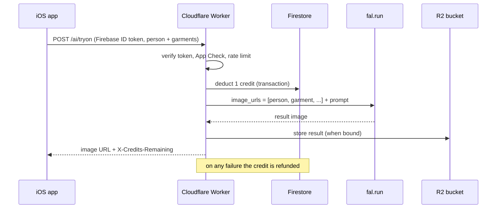
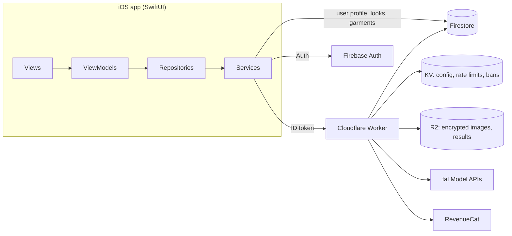

# StilYa

**Try clothes on before you buy them.** StilYa is a SwiftUI app for virtual try-on. You set up a reference photo of yourself once, then add any garment (a screenshot from a store, a photo of something in your closet) and StilYa shows you wearing it.

StilYa shipped on the App Store. This repository is the full app, open-sourced and rebuilt so that every generated image comes from [fal](https://fal.ai) Model APIs.

<p align="center">
  
  
  
  
</p>

## Features

- **Single try-on**: one garment on your photo (tops, bottoms, dresses, jackets)
- **Combos**: several garments in one generation, e.g. top + pants + jacket
- **Outfit from a flat-lay**: send a mood board or flat-lay and the model picks out each item and dresses you in all of them
- **Your own reference photo**: use a full-body photo you already have (checked on-device with Vision for one person, head to feet), or let onboarding turn 1–3 selfies into a clean full-body model photo
- **Closet and Looks**: a wardrobe you fill with your garments, and a gallery of saved results
- **Trends**: curated outfit collections you can try on with one tap
- **Private by default**: user images are encrypted on-device with AES-256-GCM before upload
- English and Turkish

## Built with fal

Every image StilYa generates comes from a fal image-edit model, called from a Cloudflare Worker. The app never sees a fal key.



- **One call per try-on.** The person photo and every garment go in a single request as `image_urls` (base64 data URIs, so there is no upload step). A three-piece combo is still one generation.
- **Models are config, not code.** To try another fal image-edit model (Seedream, FLUX.2, …), change one var in `wrangler.jsonc`. No app release needed.

  | Var | Default | Used for |
  | --- | --- | --- |
  | `FAL_MODEL_TRYON` | `fal-ai/nano-banana-2/edit` | single garments and combos |
  | `FAL_MODEL_TRYON_PRO` | `fal-ai/nano-banana-pro/edit` | outfit from a flat-lay |
  | `FAL_MODEL_PHOTO` | `fal-ai/nano-banana-pro/edit` | selfies → model photo |

- **The key stays on the server.** `FAL_KEY` is a Worker secret. The app only sends a Firebase ID token.
- **Results stay on your storage.** With an R2 bucket bound, the worker calls fal with `sync_mode: true`, so the image comes back inline, goes straight into your bucket and is not kept in fal's request history. Without R2 the worker returns the fal CDN URL, which is handy for local development.
- **Failures are cheap.** 429 and 5xx responses are retried with backoff, an empty result gets one more try, and the user's credit is refunded on any failure.

The fal client is about 100 lines: see `callFalImageEdit` in [`cloudflare-worker/worker.js`](cloudflare-worker/worker.js). The try-on prompts sit next to it in `buildNanoBananaPrompt` and `buildOutfitReplicationPrompt`.

## Architecture



### The app

Clean Architecture with MVVM and repositories, wired up by a single dependency container.

| Layer | Where | What it does |
| --- | --- | --- |
| Views | `StilYa/Modules/*/Views` | SwiftUI screens, one folder per feature |
| ViewModels | `StilYa/Modules/*/ViewModels` | screen state and actions |
| Repositories | `StilYa/Core/Repositories` | `User`, `Garment`, `Look`, `Storage`, `Auth`, `Referral`: the only layer view models talk to |
| Services | `StilYa/Core/Services` | Firebase, the worker API, R2 storage, encryption, RevenueCat, WeatherKit |
| DI | `StilYa/Core/DI/AppContainer.swift` | builds every service and repository once and injects them as an environment object |
| Navigation | `StilYa/Core/Navigation/RouterManager.swift` | path-based `NavigationStack` router with a `Destination` enum, deep links (`stilya://tryon`, `stilya://closet`) |
| Design system | `StilYa/Core/DesignSystem`, `StilYa/Core/Theme` | colors, Instrument Serif + DM Sans type scale, shared buttons, cards, toasts |

Feature modules: `Onboarding`, `Home`, `DressUp` (single, combo and outfit flows), `TryOn`, `Combo`, `Closet`, `Looks`, `Trends`, `Cart`, `Profile`, `Pro`.

The home screen is drawn as a small room rather than a grid of cards: recent looks and the trend magazine sit on a wall shelf, the wardrobe and the cart basket stand on the floor, and the remaining tries hang on a price tag. The wardrobe doors open into the closet.

### The worker

[`cloudflare-worker/worker.js`](cloudflare-worker/worker.js) is the only backend. It handles:

- **Auth**: verifies Firebase ID tokens and, when configured, App Check tokens
- **Credits**: deducted and refunded atomically in a Firestore transaction. The client can read its balance but never write it. Spend order is Pro credits, then purchased credits, then the one-time trial credit
- **AI proxy**: `/ai/tryon` and `/ai/generate-model-photo`, both on fal
- **Storage**: `/upload` and `/download` for the user's encrypted images in R2
- **Purchases**: RevenueCat purchase verification and Pro sync
- **Abuse prevention**: per-user and per-IP rate limits, bans, DeviceCheck
- **Content**: paginated trend collections, plus an admin panel for trends, credits and remote config

| Endpoint | Auth | Purpose |
| --- | --- | --- |
| `POST /ai/tryon` | user | try-on, combo or outfit (`mode: "outfit"`) |
| `POST /ai/generate-model-photo` | user | selfies → full-body model photo |
| `GET /api/credits` | user | current balance |
| `POST /api/purchase/verify`, `POST /api/sync-pro` | user | purchases and subscription state |
| `PUT /upload`, `GET /download` | user | encrypted image storage |
| `GET /api/trends`, `GET /api/config` | public | trends, remote config |
| `/admin/*` | admin secret | admin panel and tools |

### Data and privacy

- **Firestore** holds `users/{uid}` with `looks` and `garments` subcollections. [`firestore.rules`](firestore.rules) lets a user read and edit only their own documents, and only the worker can change credits or Pro status.
- **Images** (reference photo, garments, saved looks) are encrypted on-device with AES-256-GCM using a per-user key kept in the Keychain, then stored in R2 through the worker. The server only ever holds ciphertext for them.
- **Try-on inputs** go to fal for a single generation. With R2 bound, the result is stored in your bucket rather than in fal's history.

## Project layout

```
StilYa/                 SwiftUI app (iOS 17+)
  App/                  entry point, splash, root navigation
  Core/                 DI, design system, models, repositories, services, localization
  Modules/              feature modules (Onboarding, Home, DressUp, Closet, Trends, ...)
Config/                 xcconfig files: Base (committed), Secrets (yours, gitignored)
cloudflare-worker/      the backend: auth, credits, fal calls, R2 storage, admin panel
firestore.rules         Firestore security rules
.env.example            every worker secret, with what it turns on
```

## Setup

You need Xcode 16+, Node 18+, a [fal API key](https://fal.ai/dashboard/keys), and a Firebase project (Auth + Firestore).

### 1. Firebase

1. Create a Firebase project and add an iOS app with your bundle ID.
2. Enable **Authentication** (Anonymous, Apple and/or Google) and **Firestore**.
3. Download `GoogleService-Info.plist` into `StilYa/`. It is gitignored.
4. Deploy the rules: `npx firebase-tools deploy --only firestore:rules`

### 2. Worker

```bash
cd cloudflare-worker
cp ../.env.example .dev.vars     # set FAL_KEY; everything else is optional
# set FIREBASE_PROJECT_ID in wrangler.jsonc
npx wrangler dev                 # serves on http://localhost:8787
```

To deploy, run `npx wrangler secret put FAL_KEY` (and any optional secrets you use), then `npx wrangler deploy`.

Optional pieces turn on when their config is present:

| Feature | Needs |
| --- | --- |
| Credits, purchases, trends, referrals | `GOOGLE_SERVICE_ACCOUNT_JSON` |
| Server-side purchase verification | `REVENUECAT_API_KEY` |
| Rate limits, bans, remote config | `STILYA_KV` KV binding |
| Storing images and results in your own bucket | `STILYA_BUCKET` R2 binding |
| Device abuse checks | `APPLE_TEAM_ID`, `DEVICECHECK_KEY_ID`, `DEVICECHECK_PRIVATE_KEY` |
| App Check verification | `FIREBASE_PROJECT_NUMBER` |

### 3. App

```bash
cp Config/Secrets.example.xcconfig Config/Secrets.xcconfig
```

In `Config/Secrets.xcconfig`, set `STILYA_API_BASE_URL` to your worker URL and `GOOGLE_REVERSED_CLIENT_ID` from your `GoogleService-Info.plist`. Leave `REVENUECAT_API_KEY` empty to run without purchases. Then open `StilYa.xcodeproj` and run on a Simulator.

With no `Secrets.xcconfig`, the app points at `http://localhost:8787`, so `wrangler dev` and the Simulator work together out of the box.

No keys live in the repository: the app reads its config from xcconfig files through `Info.plist`, and the worker reads its secrets from Wrangler.

## License

[MIT](LICENSE) © Elif Bilge Parlak
