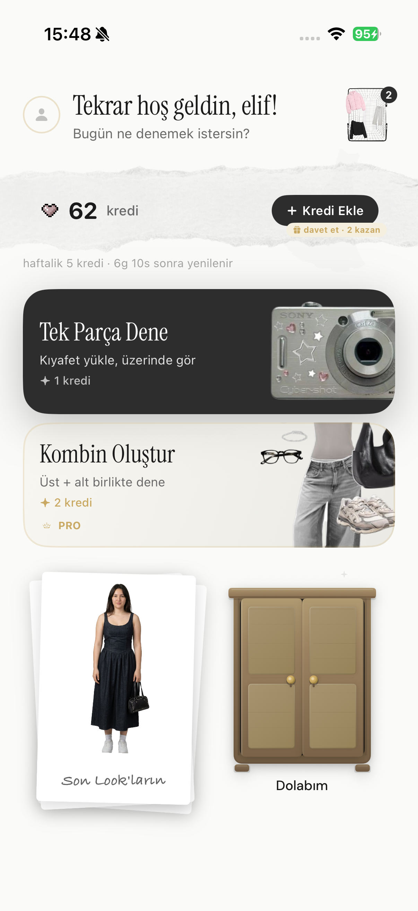
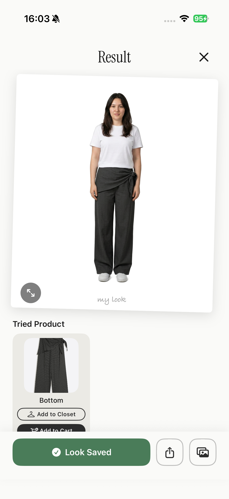
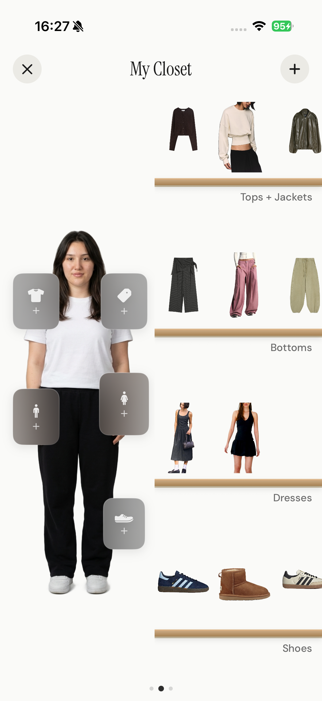
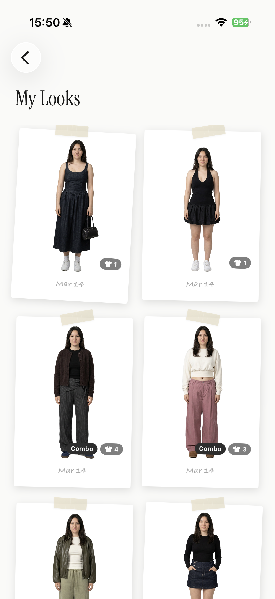

# StilYa

**Try clothes on before you buy them.** StilYa is a SwiftUI app for virtual try-on. You upload a photo of yourself once, then add any garment (a screenshot from a store, a photo of something in your closet). StilYa shows you wearing it.

StilYa was published on the App Store. This repository is the full app, open-sourced and rebuilt on [fal](https://fal.ai) Model APIs.

<p align="center">
  
  
  
  
</p>

## Features

- **Single try-on**: one garment on your photo (tops, bottoms, dresses, jackets, shoes)
- **Combos**: several garments in one generation, e.g. top + pants + shoes
- **Outfit from a flat-lay**: send a mood board or flat-lay and the model picks out each item and dresses you in all of them
- **Model photo from selfies**: onboarding turns 1–3 selfies (plus an optional body photo, height and body type) into a clean full-body photo for try-ons
- **Closet and Looks**: save garments and results, then reuse them
- **Trends**: curated outfit collections you can try on with one tap
- **Private by default**: user images are encrypted on-device with AES-256-GCM before they are uploaded
- English and Turkish localization

## Built with fal

Every image StilYa generates comes from a fal image-edit model, called from a Cloudflare Worker:

```
iOS app ──(Firebase ID token)──▶ Cloudflare Worker ──(FAL_KEY)──▶ fal.run/<model>
                                  │ auth, credits, rate limits
                                  └─▶ R2 (optional) ◀── result image
```

- **One call per try-on.** The person photo and every garment go in a single request as `image_urls` (base64 data URIs, so there is no upload step). A three-piece combo is still one generation.
- **Models are config, not code.** The defaults are below. To try another fal image-edit model (Seedream, FLUX.2, …), change one var in `wrangler.jsonc`. No app release needed.

  | Var | Default | Used for |
  | --- | --- | --- |
  | `FAL_MODEL_TRYON` | `fal-ai/nano-banana-2/edit` | single garments and combos |
  | `FAL_MODEL_TRYON_PRO` | `fal-ai/nano-banana-pro/edit` | outfit-from-flat-lay |
  | `FAL_MODEL_PHOTO` | `fal-ai/nano-banana-pro/edit` | selfie → model photo |

- **The key stays on the server.** `FAL_KEY` is a Worker secret. The app only sends a Firebase ID token.
- **Results stay on your storage.** If an R2 bucket is bound, the worker calls fal with `sync_mode: true`. The image comes back inline and goes straight into your bucket, so it is not kept in fal's request history. Without R2, the worker returns the fal CDN URL, which is handy for local development.
- **Failures are cheap.** 429/5xx responses are retried with backoff, an empty result gets one retry, and the user's credit is refunded on any failure.

The fal client is about 100 lines: see `callFalImageEdit` in [`cloudflare-worker/worker.js`](cloudflare-worker/worker.js). The try-on prompts are next to it in `buildNanoBananaPrompt` and `buildOutfitReplicationPrompt`.

## Project layout

```
StilYa/                 SwiftUI app (iOS 17+)
  Core/Services/TryOn/  TryOnService: calls the worker's /ai/tryon and /ai/generate-model-photo
  Modules/              Feature modules (Onboarding, Closet, Combo, Trends, ...)
Config/                 xcconfig files: Base (committed), Secrets (yours, gitignored)
cloudflare-worker/      The backend: auth, credits, fal calls, R2 storage, admin panel
firestore.rules         Firestore security rules
```

## Setup

You need Xcode 16+, Node 18+, a [fal API key](https://fal.ai/dashboard/keys), and a Firebase project (Auth + Firestore).

### 1. Firebase

1. Create a Firebase project and add an iOS app with your bundle ID.
2. Enable **Authentication** (Anonymous, Apple and/or Google) and **Firestore**.
3. Download `GoogleService-Info.plist` into `StilYa/`. It is gitignored.
4. Deploy the rules: `npx firebase-tools deploy --only firestore:rules`

### 2. Worker

```bash
cd cloudflare-worker
cp ../.env.example .dev.vars     # set FAL_KEY; everything else is optional
# set FIREBASE_PROJECT_ID in wrangler.jsonc
npx wrangler dev                 # serves on http://localhost:8787
```

To deploy, run `npx wrangler secret put FAL_KEY` (and any optional secrets you use), then `npx wrangler deploy`.

Optional pieces turn on when their config is present:

| Feature | Needs |
| --- | --- |
| Credits, purchases, trends, referrals | `GOOGLE_SERVICE_ACCOUNT_JSON` |
| Server-side purchase verification | `REVENUECAT_API_KEY` |
| Rate limits, bans, remote config | `STILYA_KV` KV binding |
| Storing results in your own bucket | `STILYA_BUCKET` R2 binding |
| Device abuse checks | `APPLE_TEAM_ID`, `DEVICECHECK_KEY_ID`, `DEVICECHECK_PRIVATE_KEY` |
| App Check verification | `FIREBASE_PROJECT_NUMBER` |

### 3. App

```bash
cp Config/Secrets.example.xcconfig Config/Secrets.xcconfig
```

In `Config/Secrets.xcconfig`, set `STILYA_API_BASE_URL` to your worker URL and `GOOGLE_REVERSED_CLIENT_ID` from your `GoogleService-Info.plist`. Leave `REVENUECAT_API_KEY` empty to run without purchases. Then open `StilYa.xcodeproj` and run on a Simulator.

With no `Secrets.xcconfig`, the app points at `http://localhost:8787`, so `wrangler dev` and the Simulator work together out of the box.

## License

[MIT](LICENSE) © Elif Bilge Parlak
